<p align="center">
  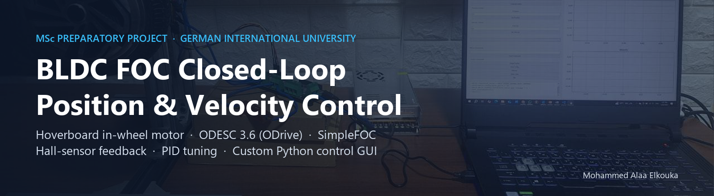
</p>

<p align="center">
  
  
  
  
  
</p>

# BLDC FOC Closed-Loop Position and Velocity Control

**Closed-loop position and velocity control of a hoverboard BLDC motor with Field-Oriented Control,
built and tuned on a custom test rig.**

MSc Robotics preparatory project, German International University (GIU) · Mohammed Alaa Elkouka ·
Supervisor: Dr. Khaled Tolba · January 2025

Standard electronic speed controllers (ESCs) are designed to control *speed*, not *position*. A
modular robot that has to move precisely over different terrains needs both. This project builds a
low-cost closed-loop position and velocity control system around a hoverboard in-wheel motor, using
its built-in Hall sensors as feedback. It compares two motor drivers, tunes the control loops on a
test rig, and adds a custom GUI to command and monitor the motor in real time.

---

## Demo

<p align="center">
  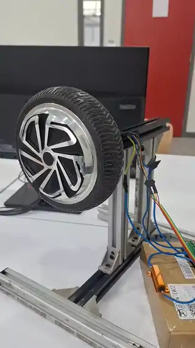
</p>
<p align="center"><i>Position control, forward and reverse, on the test rig (silent preview).</i></p>

Test videos with sound (download):

| Video | Length |
|---|---|
| [First closed-loop test](media/01_closed_loop_first_test.mp4) | 0:20 |
| [Position control: one rotation](media/02_position_control_one_rotation.mp4) | 0:25 |
| [Position control: forward and reverse](media/03_position_control_forward_reverse.mp4) | 0:26 |
| [Velocity control](media/04_velocity_control.mp4) | 0:31 |

---

## Key results

| Result | Value |
|---|---|
| Control achieved | Closed-loop **position** and **velocity** control of a hoverboard BLDC motor |
| Feedback | Built-in Hall sensors: 6 steps × 15 pole pairs = **90 counts per revolution** (~4°) |
| Best-performing driver | **ODESC 3.6** (ODrive-based): stable, accurate response |
| Best tuning found | **pos_gain = 1.4, vel_gain = 0.72**: reduced overshoot, smooth settling |
| Measured motor parameters | Phase resistance **0.116 Ω**, phase inductance **0.19 mH** |
| Alternative driver | SimpleFOC shield: poor on Arduino UNO, acceptable on ESP32 |
| Custom tool | Python GUI for calibration, position and velocity commands, live plots and emergency stop |

---

## Contents

- [The system at a glance](#the-system-at-a-glance)
- [The test rig](#the-test-rig)
- [How the control works](#how-the-control-works)
- **Following the work step by step**
  - [Step 1 · Hall-sensor feedback](#step-1--hall-sensor-feedback)
  - [Step 2 · Configuring and calibrating the driver](#step-2--configuring-and-calibrating-the-driver)
  - [Step 3 · Tuning the control loops](#step-3--tuning-the-control-loops)
  - [Step 4 · A custom control GUI](#step-4--a-custom-control-gui)
  - [Alternative driver: SimpleFOC](#alternative-driver-simplefoc)
- [Results](#results)
- [Limitations and next steps](#limitations-and-next-steps)
- [Repository structure](#repository-structure) · [Getting started](#getting-started) · [Credits](#credits)

---

## The system at a glance

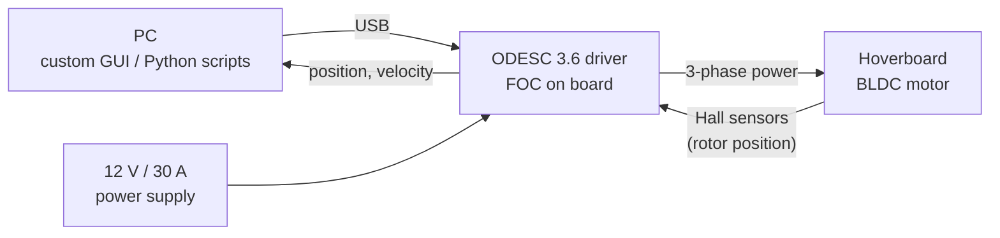

The PC sends target positions or velocities to the motor driver. The driver runs Field-Oriented
Control on its own processor, reads the rotor position from the motor's Hall sensors, and drives
the three motor phases. The GUI plots the measured position and velocity live.

---

## The test rig

A custom aluminium-profile rig holds the hoverboard wheel securely, so the motor can be run and
reversed safely during testing and tuning.

| Test rig | Complete system |
|---|---|
| 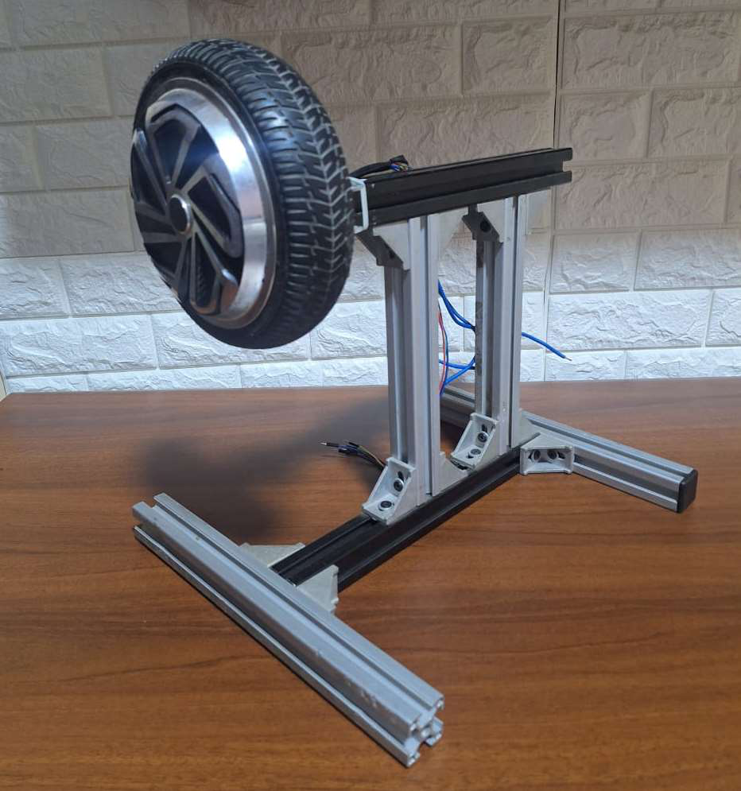 | 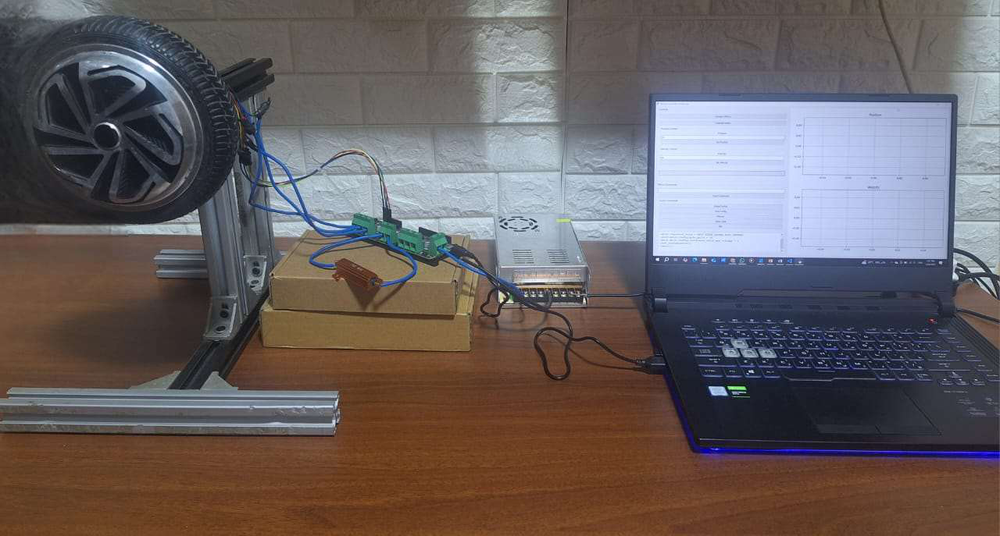 |

| Component | Details |
|---|---|
| Motor | Hoverboard in-wheel BLDC motor, 15 pole pairs (30 magnets), built-in Hall sensors |
| Main driver | ODESC 3.6: ODrive v3.6-compatible, firmware v0.5.1, on-board FOC processor |
| Alternative driver | SimpleFOC shield with Arduino UNO or ESP32 |
| Power | 12 V / 30 A power supply |
| Host | Laptop over USB, running the custom GUI and Python configuration scripts |

---

## How the control works

The driver uses **Field-Oriented Control (FOC)**. It transforms the three motor phase currents into
two components: one that produces torque and one that doesn't. It then controls them
independently, which gives smooth and efficient torque. On top of that sit three nested loops,
each feeding the target of the one inside it:

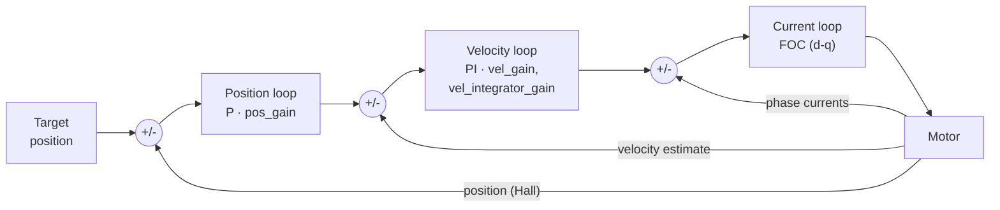

- The **position loop** turns the position error into a velocity command (`pos_gain`).
- The **velocity loop** turns the velocity error into a torque (current) command (`vel_gain`,
  `vel_integrator_gain`).
- The **current loop** makes the motor produce that torque through FOC.

For **velocity control**, the position loop is simply bypassed and a target velocity is given
directly.

---

# Following the work step by step

## Step 1 · Hall-sensor feedback

Position control needs to know where the rotor is. Instead of adding an encoder, this project uses
the Hall sensors that are already inside the hoverboard motor. They report 6 steps per electrical
revolution, and the motor has 15 pole pairs:

```
resolution = 6 steps × 15 pole pairs = 90 counts per mechanical revolution  (≈ 4° per count)
```

That's enough for this application and costs nothing extra, but it limits how finely the position
can be controlled (see [limitations](#limitations-and-next-steps)).

## Step 2 · Configuring and calibrating the driver

The motor's electrical parameters, the Hall-sensor feedback and the control mode were first set up
by hand in the ODrive command-line tool, then automated in a Python configuration script.

| Setting | Value | Note |
|---|---|---|
| `pole_pairs` | 15 | 30 magnets in the hoverboard motor |
| `torque_constant` | 8.27 / Kv = 0.517 | Kv = 16 (hoverboard motor) |
| `encoder.mode` / `cpr` | Hall / 90 | 6 × 15 Hall counts per revolution |
| `calib_scan_distance` | 150 | Longer offset-calibration scan, because Hall feedback is coarse |
| `encoder.bandwidth` | 100 | |
| `requested_current_range` | 25 A | |
| `resistance_calib_max_voltage` | 4 V | |
| `current_control_bandwidth` | 100 | |
| `vel_limit` | 10 turns/s | Safety limit |
| `control_mode` | Position control | |

**Calibration sequence:** motor calibration (measures phase resistance and inductance) → Hall
polarity and offset calibration → save configuration → reboot → closed-loop control.

Values measured by the motor calibration on this motor: **phase resistance 0.116 Ω**, **phase
inductance 0.19 mH**. The full command session is in
[`odrive_config/calibration_session_log.txt`](odrive_config/calibration_session_log.txt), and the
automated version is [`odrive_config/hoverboard_config.py`](odrive_config/hoverboard_config.py).

*Challenge:* early on the PC often failed to recognise the driver or lost communication with it.
Updating the USB drivers and the driver firmware, and checking the cable and port, fixed it.

## Step 3 · Tuning the control loops

The gains were tuned iteratively, starting from defaults and changing one gain at a time while
commanding position steps:

| pos_gain | vel_gain | Behaviour |
|---|---|---|
| 6 | 0.8 | Significant overshoot, oscillations |
| 2 | 0.5 | Stable, minimal overshoot |
| 3 | 0.5 | More overshoot than with pos_gain = 2 |
| 4 | 0.5 | Even more overshoot, oscillations |
| 2 | 0.6 | Stable, slightly smoother than vel_gain = 0.5 |
| 2 | 0.7 | Small high-frequency oscillations |
| **1.4** | **0.72** | **Reduced overshoot, smoother settling** |

The same 3-turn position step, before and after tuning (both with vel_gain = 0.72):

| pos_gain = 6: overshoot and oscillation | pos_gain = 1.4: smooth settling |
|---|---|
| 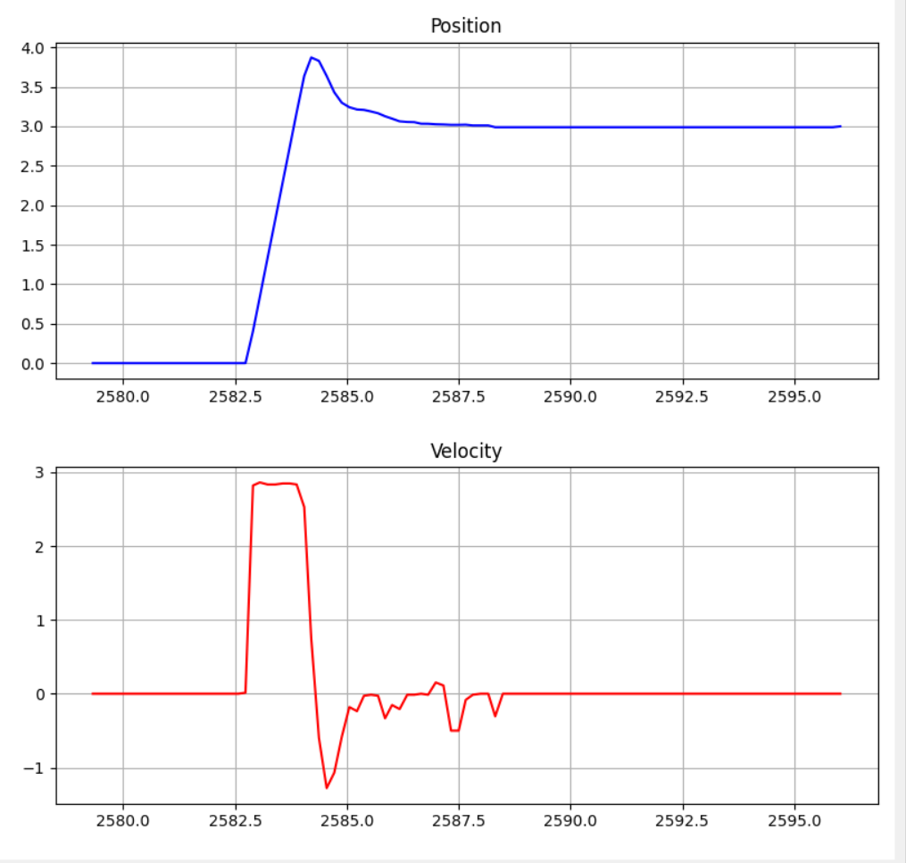 | 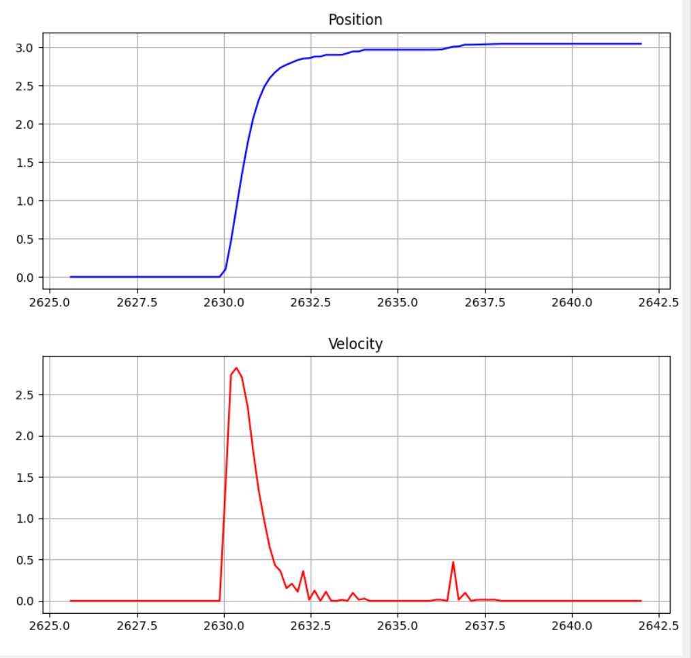 |

What each gain does:

- **pos_gain:** higher values react more aggressively to position error and settle faster, but too
  high causes overshoot and oscillation.
- **vel_gain:** the main tool for damping. Raising it damps oscillation and speeds up settling;
  too high adds high-frequency oscillation.
- **vel_integrator_gain:** removes steady-state error. It affects settling time only indirectly.

## Step 4 · A custom control GUI

The ODrive community GUI was no longer supported, so a custom one was written in Python. It
replaces typing commands in a terminal with buttons, and plots the motor's response live.

<p align="center">
  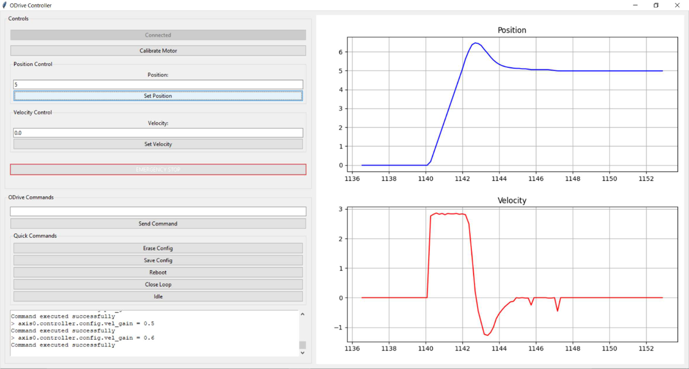
</p>

- **Connect** and **Calibrate Motor**
- **Set Position** and **Set Velocity** targets
- **Emergency stop:** puts the motor into idle immediately
- **Quick commands:** Erase Config, Save Config, Reboot, Close Loop, Idle
- **Command box:** send any ODrive command without opening a terminal
- **Live plots** of position and velocity

Built with Tkinter and Matplotlib; the code is in [`gui/`](gui).

## Alternative driver: SimpleFOC

As a lower-cost alternative to the ODESC, the motor was also driven with a **SimpleFOC shield**
controlled by a microcontroller running the SimpleFOC library
([`simplefoc/`](simplefoc/FOC_ClosedLoopPositionControl/FOC_ClosedLoopPositionControl.ino)):

- Angle (position) control mode, using the Hall sensors, with inline current sensing
- 12 V supply, 32 kHz PWM, 25 A current limit
- Velocity PID: P = 0.3, I = 5, D = 0.001; angle P = 20

Results:

- On an **Arduino UNO** the response was poor: its limited memory and speed were not enough.
- On an **ESP32** the result was acceptable.
- The **ODESC 3.6** still gave the better response time and accuracy, so it was used for the main
  results.

---

## Results

With the ODESC 3.6 and the tuned gains, the motor tracked position commands in both directions
with a stable response:

| Reverse step | Forward step |
|---|---|
| 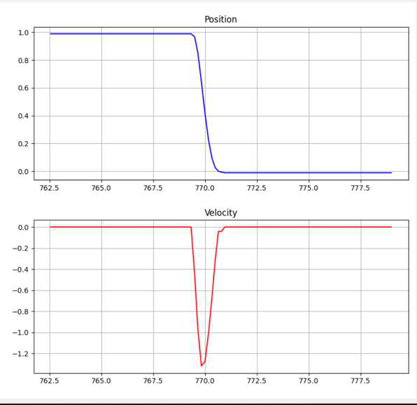 | 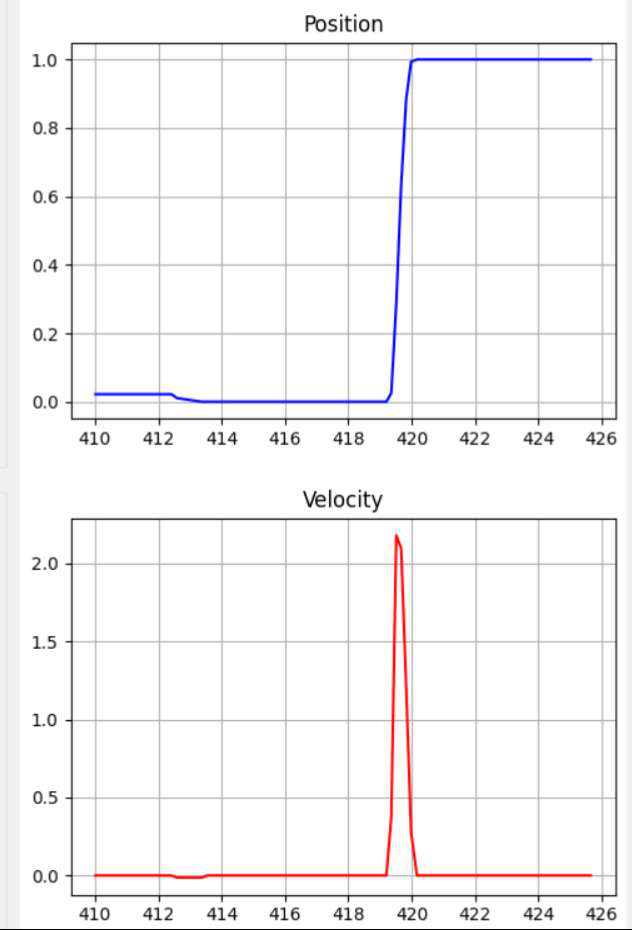 |

- **A working prototype:** closed-loop position and velocity control of a hoverboard BLDC motor,
  using only its built-in Hall sensors.
- **Two drivers compared:** the ODESC 3.6 clearly outperformed the SimpleFOC shield.
- **A tuned configuration:** pos_gain = 1.4 with vel_gain = 0.72 gave reduced overshoot and smooth
  settling.
- **Some noise and variation remains** in the response, most likely caused by the coarse Hall-sensor
  resolution.

---

## Limitations and next steps

- **Higher-resolution feedback:** 90 counts per revolution limits precision. An encoder would give
  much finer position control.
- **Systematic tuning:** replace manual iteration with structured experiments, or optimisation
  methods such as genetic algorithms for PID tuning.
- **Custom driver hardware:** the ODESC 3.6 board was studied to identify its main components
  (DRV8301 gate driver, power MOSFETs, current-sense resistors, CAN / USB / SPI interfaces). This is
  a basis for designing a custom driver PCB for robotic applications.
- **Toward the robot:** this is the first stage of a modular robotic platform for multi-terrain
  navigation, and the next step is integration into that platform.

The full details are in the [final report](docs/Final_Report_BLDC_Position_Control.pdf).

---

## Repository structure

```
├── gui/                        Custom control GUI (Python, Tkinter + Matplotlib)
├── odrive_config/              Hoverboard configuration script, calibration log, test scripts
├── simplefoc/                  SimpleFOC closed-loop position sketch (Arduino / ESP32)
├── media/                      Test videos
└── docs/                       Final report and README figures
```

## Getting started

**Requirements:** Python 3.8+, an ODrive-compatible driver (ODESC 3.6 was used, firmware v0.5.1),
and the `odrive` Python package matching your driver's firmware. Tkinter comes with Python.

```
pip install -r gui/requirements.txt
```

**Configure and calibrate a hoverboard motor** (driver connected over USB):

```
python odrive_config/hoverboard_config.py --erase_config --motor_test
```

`--erase_config` starts from a clean configuration, and `--motor_test` steps the motor through
30° increments after calibration. Other options: `--axis_num 0|1` and `--anticogging_cal`.

**Start the control GUI:**

```
python gui/main.py
```

Then press **Connect**, **Calibrate Motor**, **Close Loop**, and set a target position or velocity.
Keep the **Emergency stop** within reach.

**SimpleFOC:** open `simplefoc/FOC_ClosedLoopPositionControl/FOC_ClosedLoopPositionControl.ino` in
the Arduino IDE with the SimpleFOC library installed. The sketch uses `PciManager` pin-change
interrupts for the Hall sensors on an Arduino UNO.

## Credits

- `odrive_config/hoverboard_config.py` is adapted from, and `odrive_config/tests/` are, scripts by
  **Austin Owens**, based on the original ODrive hoverboard guide.
- The ODESC 3.6 driver is based on the open-source **ODrive** project; the SimpleFOC sketch uses the
  open-source **SimpleFOC** library.

---

## Author

**Mohammed Alaa Elkouka**
MSc Robotics, German International University (GIU) · BSc Mechatronics, Mansoura University

[LinkedIn](https://www.linkedin.com/in/muhammed-elkouka-692b11220)

---

© 2025–2026 Mohammed Alaa Elkouka. All rights reserved, except for third-party code, which remains
under its authors' terms. No part of this repository may be copied, reused or redistributed without
the author's written permission.
